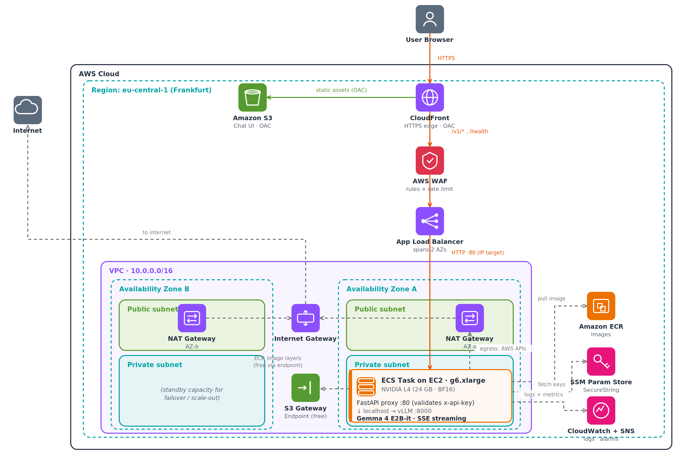

# Scalable LLM Inference Service on AWS

Self-hosted **Google Gemma 4 (E2B-it)** served with **vLLM** on an AWS GPU, with a simple chat UI. The GPU scales to zero when idle. Everything is defined in **Terraform**.

A personal project exploring end-to-end LLM deployment on AWS. The model runs on my own GPU, not a third-party API.

## Architecture



**How a request flows:** browser → CloudFront → WAF → ALB → ECS task on a GPU instance. CloudFront serves the chat UI from a private S3 bucket and forwards `/v1/*` API calls to the ALB. Inside the task, a small FastAPI proxy checks the API key and passes the request to vLLM, which streams the reply back token by token.

| Layer | Choice |
|---|---|
| Infrastructure | Terraform ≥ 1.10, AWS provider `~> 6.45` |
| Compute | ECS on EC2, `g6.xlarge` (NVIDIA L4) |
| Model server | vLLM v0.20.2 running Gemma 4 E2B-it |
| Proxy | FastAPI: API key check + streaming |
| Edge | CloudFront + WAF + ALB across 2 AZs |
| Secrets | SSM Parameter Store (encrypted) |
| Monitoring | CloudWatch dashboard and alarms, SNS email |
| CI | GitHub Actions: format, validate, tests |

- **Scale to zero:** no GPU runs when idle. The first request wakes it up, and it shuts down again after 15 idle minutes.
- **Secure by default:** private subnets, ALB reachable only from CloudFront, WAF rate limiting, API keys stored encrypted in SSM.

## Prerequisites

Works on **Linux** and **macOS**. On **Windows**, use **WSL2**.

You need:

- Terraform ≥ 1.10
- AWS CLI v2
- Docker ≥ 23 (with Buildx)
- Python ≥ 3.11
- Node.js ≥ 22 (frontend tests only)
- OpenSSL

**AWS:** an account that can create the resources above. You also need GPU quota: in Service Quotas, request **Running On-Demand G and VT instances ≥ 4 vCPU**. It isn't granted by default, and approval can take a day.

**Hugging Face:** accept Google's licence on the `google/gemma-4-E2B-it` model page, then create a read token.

## Deploy

```bash
git clone https://github.com/dinosmuc/llm-cloud-deployment.git
cd llm-cloud-deployment

export HF_TOKEN=hf_...
./scripts/deploy.sh
```

No configuration needed. On the first run, the script creates `terraform/terraform.tfvars` with two random API keys and default settings. It never overwrites that file. Delete it if you want new keys.

To change the defaults, set any of these when you run the script for the first time:

| Variable | Default | Purpose |
|---|---|---|
| `AWS_REGION` | `eu-central-1` | Region to deploy into |
| `PROJECT_NAME` | `gemma-inference` | Prefix for all resource names |
| `INSTANCE_TYPE` | `g6.xlarge` | GPU instance (must be L4-class; T4 won't work) |
| `ALERT_EMAIL` | *(empty)* | Where alarm emails are sent |

You can also copy `terraform/terraform.tfvars.example` to `terraform/terraform.tfvars` and edit it before deploying.

The script asks for confirmation twice. Set `AUTO_APPROVE=1` to skip both prompts.

What the script does:

1. Checks your tools, AWS credentials, Docker and GPU quota.
2. Creates an S3 bucket for Terraform state.
3. Creates the ECR image repository.
4. Builds and pushes the Docker image. It includes the 18 GB of model weights, so this takes **20–31 minutes** depending on your upload speed.
5. Deploys everything else.

To run Terraform by hand later: `terraform init -backend-config=backend.hcl`.

## Use

```bash
cd terraform
terraform output frontend_url
terraform output -raw public_api_key
```

Open the URL, paste the key and start chatting.

The first request after an idle period has to start the GPU. On a brand-new deploy this took about **17 minutes**, mostly pulling the 18 GB image. When warm, it takes about 5 minutes. The UI shows progress and retries on its own. Once the GPU is running, replies start in under a second.

## Run the tests

```bash
python3 -m venv .venv && source .venv/bin/activate
pip install -r tests/requirements.txt
./scripts/check.sh
```

No AWS account, deployment or Docker needed. The 28 tests cover Terraform formatting and validation, the API key proxy, how the UI handles streamed replies, and whether the config files and scripts stay consistent. GitHub Actions runs the same checks on every push and pull request.

## Tear down

```bash
./scripts/destroy.sh                   # add AUTO_APPROVE=1 to skip the prompt
PURGE_STATE=1 ./scripts/destroy.sh     # also delete the Terraform state bucket
```

`terraform/terraform.tfvars` must still exist. Teardown takes about 50 minutes, mostly waiting for the ECS service to drain. If Terraform times out, the script retries once automatically. At the end it checks for leftover resources, but treat that as a quick check, not a guarantee.

The state bucket is kept unless you set `PURGE_STATE=1`.

## Cost

When idle, the stack costs about **$0.16/hour (~$119/month)**. Most of that is the two NAT Gateways (~$76), the ALB (~$20) and public IP addresses (~$15). The GPU (~$1.01/hour for `g6.xlarge`) only runs while it's serving requests.

These are eu-central-1 prices as of 20 September 2026. They leave out storage, data transfer, CloudFront, S3, CloudWatch and taxes. **Tearing the stack down when you're not using it saves the most.**

## Troubleshooting

| Problem | Fix |
|---|---|
| `VcpuLimitExceeded` or the instance never launches | GPU quota not granted yet. See [Prerequisites](#prerequisites). |
| Image build fails downloading the model | Export `HF_TOKEN` and accept Google's licence. |
| `denied: authorization token has expired` | The ECR login lasts 12 hours. Re-run `./scripts/deploy.sh`. |
| No alarm emails | Set `alert_email` and confirm the SNS subscription email. Alarms still show in CloudWatch. |
| UI stuck on "Still warming up" | Normal during a cold start (it retries for ~22 minutes). If it takes longer, check the ECS service events and the `/ecs/<project>/vllm` logs. |
| `terraform init` asks for a bucket | Add `-backend-config=backend.hcl`, or just use `./scripts/deploy.sh`. |

## Limitations

- **Not highly available.** There's one GPU task and it scales to zero, so the service is unavailable during a cold start.
- **No end-to-end TLS.** Traffic from CloudFront to the ALB is plain HTTP. Fixing this needs a custom domain and certificate.
- **The ALB lock-down is partial.** It only accepts traffic from CloudFront, but it can't tell this CloudFront distribution apart from someone else's.
- **Rate limiting is best-effort.** It goes by the `X-Forwarded-For` address, which callers can fake.
- **Autoscaling is basic.** Scaling out effectively never triggers, because the threshold hasn't been load-tested. Waking from zero briefly starts two instances but uses only one. Scaling in goes straight back to zero after 15 idle minutes.
- **Single-turn chat.** The UI doesn't keep conversation history.
- **Five WAF rules only log.** They're set to count instead of block, because they flagged normal chat text.
- **AZs aren't checked for GPU support.** If `g6` isn't offered in the chosen zones, the task stays pending.

## License

MIT. See [LICENSE](LICENSE).
